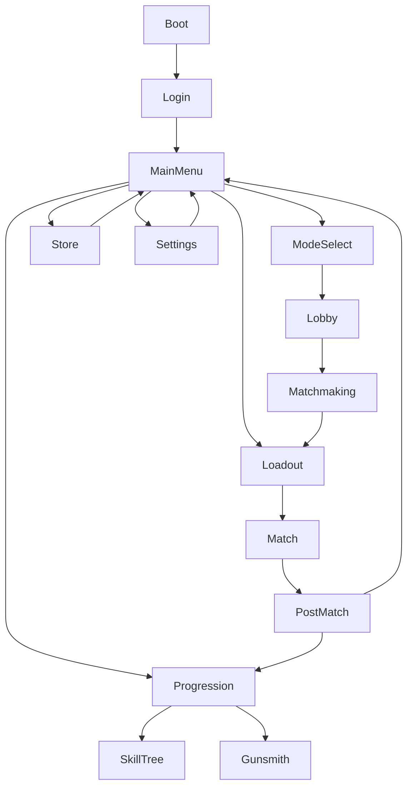

# COMBAT PROTOCOL: FRONTLINE — GDD Supplement v1.1

**تاريخ الإصدار:** 24 أكتوبر 2026
**الغرض:** سد فجوات الصوت، UX، الاقتصاد، الوصول، التعريب، والامتثال قبل بدء إنتاج UE5
**حالة الوثيقة:** جاهزة للتنفيذ كـ design/production specification

> هذا المستند مكمل لـ `docs/COMBAT_PROTOCOL_GDD.md`. إذا تعارضت قيمة تجريبية هنا مع Telemetry لاحقة، تعتمد Telemetry بعد مراجعة المصمم والمنتج.

## جدول المحتويات

1. [Audio Design Bible](#1-audio-design-bible)
2. [UI/UX Flow](#2-uiux-flow)
3. [Economy & Customization](#3-economy--customization)
4. [Accessibility Guidelines](#4-accessibility-guidelines)
5. [Localization](#5-localization)
6. [Legal & Compliance](#6-legal--compliance)
7. [Implementation checklist](#7-implementation-checklist)

---

## 1. Audio Design Bible

### 1.1 الهوية السمعية

هوية الصوت هي **Industrial precision**: أصوات ميكانيكية واضحة، transient قوي، وطبقات جوية تربط اللاعب بالميناء/المنشأة. الصوت لا يقلد تسجيلات أسلحة حقيقية بعينها؛ المراجع تستخدم لفهم الوظيفة فقط، وكل asset نهائي يُسجل أو يُصمم أصلياً أو يُشترى بترخيص تجاري صالح.

### 1.2 طبقات SFX للأسلحة

| الفئة | Fire layers | Reload | Recoil/handling | Dry fire | Hit marker | Kill confirm |
|---|---|---|---|---|---|---|
| AR | close transient + mid body + mechanical click + distant tail | mag out/in + bolt + cloth + servo | camera thump منخفض + casing + controller haptic | dry click + UI tick | hit tick + material layer | short low thud + confirm chime |
| SMG | transient قصير + 2 body layers + fast tail | mag snap + slide + hand movement | fast mechanical ticks + light camera kick | sharp double click | brighter tick، أقل low-end | compact two-note confirm |
| DMR | loud crack + body + bolt + environment tail | bolt cycle + magazine + stock contact | distinct single kick + brass | heavy click | high clarity hit tick | metallic low hit + UI rise |
| Sniper | crack + sub boom + tail + distant reflection | bolt + shell + bipod/stock contact | long camera thump + ringing tail | isolated heavy click | sparse high-priority tick | deep confirm + short harmonic |
| Pistol | transient + slide + grip contact | slide lock + mag + chamber | dry mechanical kick + casing | compact click | clean center tick | short bright confirm |
| Melee | swing whoosh + grip + impact material | equip/holster + cloth | camera impulse + impact resonance | لا يوجد | impact only | heavier impact + confirm stinger |

#### قواعد الصوت

- Fire صوت local فوري للـ shooter، وremote fire نسخة أقل حدة حسب المسافة.
- لا نستخدم sample واحداً متكرراً: 4–8 variations لكل layer مع pitch/volume variation محدود.
- كل سلاح لديه `Near`, `Mid`, `Far`, `IndoorTail`, `Suppressed` events.
- الـ hit marker يُسمع فقط عند hit confirmed من السيرفر؛ لا نؤكد miss بصوت مزعج.
- Kill confirm لا يتغلب على Voice Line أو team-critical ping.

#### مصادر الإلهام والترخيص

Soundly وBoom Library وPro Sound Effects تصلح كمراجع أو مصادر شراء فقط بعد مراجعة الرخصة لكل asset. لا تُنسخ أصوات علامة تجارية، ولا تُستخدم مكتبة بترخيص شخصي داخل لعبة تجارية. مسار بديل: تسجيل Foley داخلي + synthesis في Reaper/REAPER + FMOD/Wwise.

### 1.3 SFX البيئة

| السطح/العنصر | طبقات التنفيذ | متى يُشغل |
|---|---|---|
| Concrete | heel slap + grit + low room | walk/run على الخرسانة |
| Metal | resonant ping + heel + vibration tail | catwalk/containers |
| Wood | dry thump + creak | السوق والصناديق |
| Grass | soft brush + soil step | Cloud Forest |
| Water | splash + shoe drag + droplets | Floodplain |
| Chest | latch + hinge + loot reveal sparkle | فتح صندوق |
| Door | motor/hinge + lock state + impact | فتح/إغلاق/كسر |
| Wind | filtered broadband + cable rattle | المناطق المفتوحة |
| Rain | roof layer + exposed layer + puddle impacts | طقس المطر |

#### Surface routing

يحدد `PhysicalMaterial` نوع السطح. يقوم `FootstepComponent` باختيار event وvariation وocclusion، ولا يقرر السطح من اسم mesh. في mobile تُخفّض تفاصيل droplets وfar tails لا طبقة الخطوة الأساسية.

### 1.4 Voice Lines للشخصيات

| Hero | Voice personality | Spawn | Ability | Ultimate | Low HP | Death | Kill | Revive |
|---|---|---|---|---|---|---|---|---|
| Rook | حاد، سريع، ثقة عملية | mission brief | breach call | overdrive call | short breath | accepts loss | aggressive short confirm | “stand up” |
| Bulwark | هادئ، ثقيل، حامٍ | defensive read | deploy warning | field command | controlled strain | calm last line | low-key confirm | protective |
| Sable | دافئ، مباشر، مطمئن | team check | medical cue | triage command | worried but composed | empathy | supportive confirm | clear instruction |
| Wisp | منخفض، ذكي، مقتصد | signal check | scan cue | target callout | whisper urgency | cryptic exit | data-like confirm | location-based |
| Ember | حماسي، ساخر، ناري | ignition line | zone warning | heatwave phrase | irritated breath | defiant | playful confirm | “move, move” |
| Atlas | تقني، دقيق، جاف | system boot | turret status | aegis protocol | diagnostic stress | system shutdown | telemetry confirm | repair instruction |

كل line له:

- نسخة first-person وthird-person.
- أولوية: critical gameplay > team callout > flavor.
- subtitle key وspeaker key.
- cooldown لمنع تكرار line خلال 6–12 ثانية.
- local mute/volume وبديل نصي.

### 1.5 Adaptive Music

#### الطبقات

1. **Exploration:** pulse خفيف، texture جوي، BPM 80–96.
2. **Combat:** drums/bass وstems إضافية، BPM 110–132.
3. **Final Circle:** motif مضغوط، heartbeat/sub pulse، BPM 128–150.

#### Transition rules

```text
Exploration
  ├─ enemy visible OR damage received → Combat pre-roll (≤250ms)
  ├─ combat score < threshold for 8s → Combat release → Exploration
  └─ BR circle phase >= 4 OR playersAlive <= 10 → Final Circle

Combat
  ├─ critical team objective → add tension stem
  ├─ player dead/spectating → reduce to Exploration bed
  └─ Final Circle condition → sync at next bar boundary
```

لا يتم قطع الموسيقى فوراً؛ الانتقال يكون عند bar boundary أو stinger priority إذا حدث knock/elimination حاسم.

### 1.6 Mix وDucking

| Bus | المستوى الافتراضي | ملاحظات |
|---|---:|---|
| Master | 0 dB | limiter -1 dBTP |
| SFX | -3 dB | gameplay priority |
| Voice | -2 dB | side-chain duck للموسيقى |
| Music | -8 dB | duck -6 dB عند critical VO |
| UI | -5 dB | لا يتجاوز hit/voice |
| Ambience | -12 dB | dynamic حسب indoor/outdoor |

Ducking:

- Voice critical: Music -6 dB خلال line + 150ms.
- Team ping: Ambience -2 dB لمدة 300ms.
- Final Circle: Music +2 dB، لكن SFX لا يتغير.
- Menu: Music -4 dB عند focus narration.

### 1.7 الأدوات وPipeline

**الاختيار:** Wwise للنسخة الإنتاجية الكبيرة؛ FMOD مقبول للـ prototype والصغيرة. Wwise مفضل هنا بسبب States/Switches وprofiling وintegration مع Unreal وspatial audio.

```text
Brief → Record/Source → Edit/Clean → Layer → Event Naming
      → Wwise/FMOD Event → Mix Snapshot → Unreal Integration
      → Multiplayer/Distance Test → Mobile Mix → Localization → Ship
```

Naming:

```text
Play_SFX_WPN_AR4_Fire_Near
Play_SFX_Footstep_Concrete_Run_01
Play_VO_Hero_Rook_Ultimate_01
State_Music_BR_FinalCircle
RTPC_SFX_Occlusion
```

---

## 2. UI/UX Flow

### 2.1 خريطة الشاشات



قاعدة التنقل: أي وظيفة أساسية تصل خلال ≤3 نقرات من Main Menu، وEscape/Back يرجع خطوة واحدة دون فقد التغييرات غير المحفوظة.

### 2.2 Wireframes نصية

#### Main Menu

```text
┌──────────────────────────────────────────────────────┐
│ LOGO                 [Profile] [News] [Settings]     │
│                                                      │
│               [ PLAY ]                               │
│     [Mode] [Loadout] [Progression] [Store]            │
│                                                      │
│ XP bar / Season / Featured cosmetic                  │
└──────────────────────────────────────────────────────┘
```

#### Loadout Screen

```text
┌──────────────┬─────────────────────────┬─────────────┐
│ Heroes       │ 3D preview + stats       │ Team role   │
│ Rook         │ ability cards            │ Passive     │
│ Bulwark      │                           │ Primary    │
│ Sable ...    │                           │ Ultimate    │
├──────────────┼─────────────────────────┼─────────────┤
│ Weapon slots │ AR-4 / SMG-9 / P-12      │ [Equip]     │
│              │ [Attachments] [Inspect]   │ [Save]      │
└──────────────┴─────────────────────────┴─────────────┘
```

#### Gunsmith Screen

```text
┌───────────────┬──────────────────────────────┐
│ AR-4 Lv 14    │ Weapon preview / stat bars   │
│ Level 1–30    │ Damage  ███████              │
│ ├─ Optic      │ Range   ██████                │
│ ├─ Barrel     │ Handling █████                │
│ ├─ Magazine   │ [Compare base] [Equip]        │
│ └─ Apex Lv30  │ Trade-offs shown in red/green │
└───────────────┴──────────────────────────────┘
```

#### Progression

```text
┌────────────┬──────────────────────────────┐
│ Hero Level │ XP 7,240 / 9,100              │
│ 1 ───── 50 │ [Skill Points: 4]            │
│            │ Assault  Survival  Team      │
│            │  ○──○──○    ○──○──○  ○──○──○ │
│            │ [Respec] [Challenges]         │
└────────────┴──────────────────────────────┘
```

#### Store

```text
┌────────────────────────────────────────────────┐
│ FEATURED  48:00:00                             │
│ [Skin 1200 Tokens] [Charm 300] [Emote 800]     │
│ [Battle Pass 950 Tokens]                       │
│ Every item shows: owned / price / rarity       │
└────────────────────────────────────────────────┘
```

لا يوجد زر شراء مخفي داخل زر equip، ولا يعرض المتجر قدرات أو damage أو attachments قتالية مدفوعة.

### 2.3 HUD Layout

#### BR

```text
TOP-LEFT: squad portraits / armor / alive count
TOP-CENTER: zone phase + timer + next circle
TOP-RIGHT: minimap + compass
CENTER: crosshair / hit marker / ability reticle
BOTTOM-LEFT: health / armor / status effects
BOTTOM-CENTER: ability cooldowns + ultimate charge
BOTTOM-RIGHT: weapon / ammo / attachments / inventory
RIGHT: kill feed / team events
```

#### TDM

```text
TOP-CENTER: team score 32 — 28 + match timer
TOP-LEFT: ally roster / streaks
TOP-RIGHT: compact minimap
CENTER: crosshair / objective marker
BOTTOM: health / abilities / weapon / ammo
RIGHT: kill feed with team colors
```

Rules:

- critical state has at least two channels: color + icon/text/audio.
- no element covers crosshair during fire.
- safe zone warning appears at least 20s before damage begins.

### 2.4 UX Principles

| principle | measurable target |
|---|---|
| الوصول | ≤3 clicks لأي وظيفة أساسية |
| Loading | boot/menu ≤5s cached، matchmaking target ≤60s |
| Error | رسالة human-readable + action + error code hidden in details |
| Loading state | skeleton/animated placeholder، لا شاشة جامدة >1s |
| Empty state | سبب واضح + CTA، مثال: “لا توجد عناصر مملوكة” |
| Unsaved | modal عند Back إذا تغير loadout |
| Controller | focus ring دائم، navigation loop بلا mouse |
| Mobile | controls قابلة للتحريك والحجم، لا نص أصغر من 12sp |

### 2.5 Figma Structure

```text
Figma File: CP-FL UX
├─ 00 Foundations (color/type/spacing/icons)
├─ 01 Components (buttons/cards/tabs/modals/HUD)
├─ 02 Main Flow
├─ 03 Match Flow
├─ 04 BR HUD
├─ 05 TDM HUD
├─ 06 Gunsmith
├─ 07 Progression
├─ 08 Store
├─ 09 Mobile
└─ 10 Accessibility & Localization
```

كل component له Default / Hover / Focus / Pressed / Disabled / Error / RTL variants.

---

## 3. Economy & Customization

### 3.1 العملات

| العملة | المصدر | Earn rate | الاستخدام |
|---|---|---:|---|
| Credits | مباريات، مهام، seasonal track | 80–160 يومياً للاعب نشط | عناصر تجميلية أساسية، respec fee، banners |
| Tokens | شراء حقيقي أو premium pass | لا تُكسب من الفوز | skins premium، battle pass، bundles |

لا يمكن تحويل Tokens إلى Credits أو شراء gameplay power. `Credits` لها daily cap مقترح 1,500؛ يمنع farming غير المحدود ويدعم الإيقاع.

### 3.2 نموذج الربح

- Hero Skins: 800–1,800 Tokens.
- Weapon Skins: 500–1,200 Tokens.
- Charms: 200–500 Tokens.
- Emotes: 400–900 Tokens.
- Battle Pass: 950 Tokens، مع track مجاني.
- Bundles تعرض السعر المفصل والقيمة الفردية، دون dark pattern.

### 3.3 Battle Pass

| البند | القرار |
|---|---|
| المدة | 10 أسابيع |
| المستويات | 100 |
| السعر | 950 Tokens، مع bundle اختياري 1,300 يبدأ من level 10 |
| Free track | 40% من cosmetics، Credits، banners، 1 skin أساسي |
| Premium track | cosmetics إضافية، emotes، weapon skins، 1,200 Tokens قابلة للاسترداد |
| التقدم | Battle Pass XP من daily/weekly/seasonal + match XP |
| catch-up | الأسبوع الأخير يضاعف mission XP لا السعر |

### 3.4 Rotating Store

- 4–6 عناصر كل 48 ساعة.
- Timer يظهر timezone-independent server time.
- لا عنصر gameplay أو power.
- لا يُحذف عنصر مشتراه من inventory.
- العناصر الأسطورية تعود خلال 30–60 يوماً، مع سجل ظهور للاعب.

### 3.5 المهام

#### Daily — 3 مهام

| المهمة | المكافأة |
|---|---:|
| أكمل مباراة واحدة | 250 XP + 80 Credits |
| نفذ 10 assists أو kills | 350 XP + 100 Credits |
| استخدم ability 8 مرات | 300 XP + 80 Credits |

#### Weekly — 5 مهام

| المهمة | المكافأة |
|---|---:|
| أكمل 10 مباريات | 2,000 XP + 500 Credits |
| حقق 25 kills مع فئتين مختلفتين | 2,500 XP + 600 Credits |
| اربح TDM مرتين | 2,000 XP + 500 Credits |
| أصلح/اعالج 2,500 HP | 2,200 XP + 550 Credits |
| أصل إلى Top 10 في BR ثلاث مرات | 3,000 XP + 700 Credits |

### 3.6 Anti-exploit للاقتصاد

- Credits لا تُمنح من custom lobby أو match private غير مصنف.
- cap على XP/credits لكل account/day؛ لا cap على match skill rating.
- server هو مصدر النتيجة، لا client.
- كشف boosting عبر repeated party، kill trading، AFK patterns وunusual surrender timing.
- reversible grant ledger: كل grant له `event_id`, `source`, `timestamp`, `server_match_id`.
- refund وchargeback workflow منفصل عن inventory mutation.

### 3.7 Catalog Data Table

| الاسم | النوع | الندرة | السعر | الحصول |
|---|---|---|---:|---|
| Rook: Copperline | Hero Skin | Rare | 900 Tokens | Store/Pass |
| AR-4: Dust Circuit | Weapon Skin | Epic | 1,200 Tokens | Store |
| Meridian Patch | Banner | Common | 150 Credits | Daily |
| Relay Drone | Charm | Rare | 350 Tokens | Store |
| Ember: Thermal Bloom | Hero Skin | Legendary | 1,800 Tokens | Store/season |
| Signal Lost | Emote | Epic | 700 Tokens | Pass |
| Season 01 Badge | Emblem | Rare | Free | Level 40 pass |
| Old Market Trail | Drop Trail | Epic | 800 Tokens | Pass |

---

## 4. Accessibility Guidelines

المرجع التشغيلي: Xbox Accessibility Guidelines (XAG) وGame Accessibility Guidelines. هذه مراجع تصميم واختبار وليست شهادة قانونية بحد ذاتها.

### 4.1 Input

- كل action قابل للـ remap.
- 3 profiles محفوظة: Keyboard/Mouse، Controller، Touch.
- duplicate binding يعرض conflict resolution، لا يفشل بصمت.
- Hold/Toggle لكل Aim، Crouch، Sprint، Interact.
- Auto-sprint، bumper swap، one-button ability option.
- Aim assist قابل للتعديل في PvE/Practice؛ في Ranked له قواعد موحدة معلنة.

### 4.2 Color blindness

أوضاع Protanopia / Deuteranopia / Tritanopia مع:

- تغيير palette للـ ally/enemy/zone/rarity.
- icon + pattern + text بجانب اللون.
- preview داخل Settings.

### 4.3 النص والصوت

- Small/Medium/Large text مع dynamic scaling 100–150%.
- subtitles لكل voice line مع background opacity.
- Speaker Name toggle، color مستقل، وspeaker icon.
- menu narration وscreen reader labels.
- لا تعتمد المعلومات الأساسية على الصوت وحده.

### 4.4 الحركة والضوء

- Motion Reduction: screen shake off، camera bob low/off، motion blur off، flash intensity slider.
- photosensitivity warning وdisable strobe.
- FOV range مع تحذير من motion sickness.

### 4.5 واجهات ذوي الاحتياجات الحركية

- Hold/Toggle Aim.
- Auto-Sprint.
- interaction hold duration 0.1–1.0s.
- controller dead zone/response curve.
- touch buttons movable، scale 80–140%، opacity 20–100%.
- لا يُطلب ضغطات متزامنة غير ضرورية في menu.

### 4.6 اختبار accessibility

- اختبار داخلي مع keyboard-only، screen magnification، color filters، no-audio، one-hand controller.
- Accessibility QA ضمن كل release gate.
- لا ندعي أن اللعبة متوافقة مع screen readers أثناء gameplay؛ الدعم الملتزم يقتصر على menus والنماذج النصية.

---

## 5. Localization

### 5.1 لغات الإطلاق

1. العربية — الأولوية، RTL.
2. الإنجليزية — source language.
3. الفرنسية.
4. الإسبانية.
5. التركية.

### 5.2 RTL

- `dir=rtl` للعربية، وليس reverse string يدوياً.
- mirror للـ layout لا للأيقونات الاتجاهية التي تحمل معنى عالمي مثل crosshair/compass.
- الأرقام، timecode، weapon IDs وkeybinds تبقى LTR داخل spans مع `dir=ltr`.
- kill feed وscoreboard لهما قواعد bidi ثابتة.
- screenshots وreview على portrait/landscape.

### 5.3 الخطوط

- عربي: Cairo أو IBM Plex Sans Arabic حسب الترخيص والأداء.
- لاتيني: Inter أو IBM Plex Sans متوافق.
- fallback stack يدعم glyph coverage للغات الخمس.
- لا نضع `letter-spacing` على العربية.

### 5.4 String Management

```text
locales/
├─ ar.json
├─ en.json
├─ fr.json
├─ es.json
└─ tr.json
```

مفتاح مثال:

```json
{
  "hud.zone.next": "الدائرة التالية",
  "weapon.ar4.name": "AR-4",
  "hero.rook.ultimate": "تم تفعيل Overdrive"
}
```

لا يُكتب النص داخل Blueprint/C++/JS مباشرة إلا في debug. كل key له context وmax length وtranslator note.

### 5.5 Cultural Review

- لا رموز دينية أو سياسية أو أعلام دول داخل cosmetics دون مراجعة.
- تجنب ألوان/إشارات قد تحمل دلالة سياسية أو طائفية في POI.
- أسماء الشخصيات والمناطق تُراجع محلياً لتجنب slang أو معنى مسيء.
- voice casting متعدد اللهجات لكن لا نربط الكفاءة القتالية بلهجة/جنسية.

### 5.6 Expansion 30–40%

- UI containers تتمدد ولا تعتمد على width ثابت.
- truncation ممنوع للنصوص الحرجة؛ استخدم wrap أو tooltip.
- localized screenshots ضمن Figma.
- pseudo-localization قبل الترجمة (`[!!! long text !!!]`) لاكتشاف overflow.

---

## 6. Legal & Compliance

> هذا قسم تصميم وامتثال أولي وليس استشارة قانونية. قبل الشحن يجب أن يراجعه محامٍ في كل سوق، خصوصاً للخصوصية، المدفوعات، القاصرين، الصوت والـ IP.

### 6.1 Privacy Policy data map

| البيانات | الغرض | retention | الحماية |
|---|---|---|---|
| Account ID / auth | تسجيل الدخول | عمر الحساب + deletion request | encryption/access control |
| Telemetry | balance/performance/anti-cheat | 13 شهراً افتراضياً | pseudonymized |
| Match data | history/leaderboards | 24 شهراً أو policy | role-based access |
| Payment receipt | fulfillment/refund | حسب قانون الضرائب/الدفع | payment provider tokenization |
| Voice/chat reports | moderation | مدة التحقيق + policy | limited staff access |
| Device/platform | compatibility/fraud | أقصر مدة لازمة | minimization |

حقوق المنتج:

- access/export/correction/deletion request workflow.
- consent وlegitimate-interest mapping لكل event.
- privacy settings داخل اللعبة، وليس فقط رابط خارجي.
- data deletion يزيل identifiers ويدخل legal hold فقط عند سبب موثق.
- breach response، DPA مع vendors، وsubprocessor inventory.

### 6.2 Terms of Service

يجب أن تغطي:

- license limited للوصول للعبة.
- ملكية العلامة والكود والأصول الأصلية.
- قواعد السلوك: griefing، hate speech، boosting، cheating، chargeback fraud.
- العقوبات: warning → temporary suspension → permanent ban، مع appeal channel.
- purchases: pricing، region، refund policy، accidental purchase handling.
- service availability، maintenance، beta disclaimers.
- UGC إن وُجد: license/rights/takedown.

### 6.3 Rating target

الهدف الأولي: **ESRB T** و **PEGI 12 أو 16 بحسب درجة العنف النهائية**، وليس قراراً نهائياً قبل submission.

- لتقوية فرصة T/PEGI 12: لا دماء واقعية، لا gore، لا تعذيب، لا profanity قوي، لا gambling.
- In-game purchases وUsers Interact تظهر كـ interactive elements حسب نظام التصنيف.
- إن أضفنا random items مع شراء حقيقي، يجب نشر الاحتمالات؛ policy المنتج الأنظف هو عدم استخدام loot boxes المدفوعة.

### 6.4 Music licensing

الخيار المفضل:

1. Original commissioned score مع عقد work-for-hire أو license عالمي دائم.
2. Soundly/Boom/Pro Sound Effects بترخيص ألعاب تجاري واضح.
3. Epidemic Sound أو مكتبة royalty-free فقط بعد التأكد من أن ترخيص enterprise يغطي game distribution، trailers، streams وUGC.

لكل asset:

```text
asset_id / creator / license_type / territories / term
platforms / modification_rights / attribution / cue_sheet
```

### 6.5 حماية القاصرين

- Parental controls وspending limit.
- age gate لا يعتمد وحده على checkbox للخصائص الحساسة.
- إخفاء/تعطيل voice/text chat للقاصرين حسب parental setting.
- report/block/mute سهل خلال ≤2 خطوات.
- لا targeted advertising للأطفال.
- receipts وpurchase confirmation وPIN/OS-level controls.

### 6.6 References

- Xbox Accessibility Guidelines: Microsoft Game Dev / Learn.
- ESRB Ratings Guide وInteractive Elements.
- CPPA/CCPA rights and deletion/opt-out guidance.
- GDPR Article 17 erasure وحقوق data subject.
- مراجعة محامي privacy/consumer/ratings قبل soft launch.

---

## 7. Implementation checklist

### أول 30 يوماً

- [ ] Wwise project وbus hierarchy.
- [ ] Audio naming sheet و10 weapon events للـ prototype.
- [ ] Figma foundations + main flow + HUD.
- [ ] accessibility settings schema.
- [ ] localization JSON keys + pseudo-loc.
- [ ] economy ledger schema مع server-only grants.
- [ ] legal data inventory وdraft privacy/toS مع counsel.

### Definition of Done

- SFX critical لها near/mid/far وvariation.
- أي وظيفة أساسية ≤3 clicks.
- colorblind/subtitle/remap tests تعمل.
- كل purchase cosmetic فقط ومثبت في catalog schema.
- لا random paid item في الإصدار الأول.
- كل event telemetry له owner وretention وprivacy classification.
