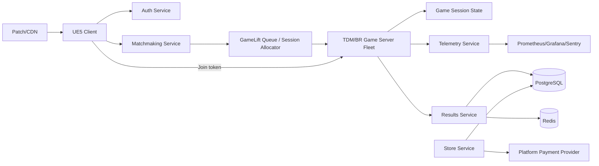

# COMBAT PROTOCOL — Dedicated Server Architecture

**هدف:** تشغيل TDM وBattle Royale على خوادم authoritative مع اقتصاد ومطابقة ومراقبة قابلة للتوسع
**التوصية:** AWS GameLift للـ TDM/soft launch، ثم إدخال self-hosted fleet عند ثبات load profile ونمو اللاعبين

## جدول المحتويات

1. [Executive decision](#1-executive-decision)
2. [Provider comparison](#2-provider-comparison)
3. [System architecture](#3-system-architecture)
4. [Services and data](#4-services-and-data)
5. [Netcode](#5-netcode)
6. [Matchmaking](#6-matchmaking)
7. [Security and anti-cheat](#7-security-and-anti-cheat)
8. [Scaling and regions](#8-scaling-and-regions)
9. [Monitoring and SLOs](#9-monitoring-and-slos)
10. [Cost model](#10-cost-model)
11. [Launch plan](#11-launch-plan)
12. [Actionable next steps](#12-actionable-next-steps)

---

## 1. Executive decision

### القرار

1. **Phase 0/Prototype:** local Three.js + bot simulation.
2. **TDM alpha:** AWS GameLift managed fleets، matchmaking service منفصل، PostgreSQL/Redis managed.
3. **BR alpha:** GameLift fleet منفصل بـ 30Hz، server build مستقل، capacity reservations حسب region.
4. **Scale:** عند وصول telemetry مستقرة وfleet utilization معروف، نقارن GameLift المستمر مع self-hosted/EC2 أو container fleet.

### لماذا لا نبدأ self-hosted بالكامل؟

- يقلل زمن بناء provisioning، session lifecycle، health checks وfleet scaling.
- يتيح اختبار gameplay قبل أن يصبح فريق اللعبة فريق DevOps.
- المقابل هو تكلفة أعلى وlock-in؛ لذلك interfaces تبقى provider-agnostic.

### لماذا لا نعتمد PlayFab وحده؟

PlayFab مناسب لـ identity/economy/matchmaking/leaderboards، لكنه لا يلغي قرار استضافة authoritative Unreal servers. يمكن استخدام PlayFab backend مع GameLift server fleet، لكن نحتاج contract واضح بينهما.

---

## 2. Provider comparison

| الحل | المزايا | العيوب | الاستخدام المقترح |
|---|---|---|---|
| AWS GameLift | تكامل game sessions/fleets، autoscaling، queue/FlexMatch، regional fleets | تكلفة/تعقيد AWS، vendor coupling، مراقبة وتكامل مطلوبان | TDM/BR alpha وsoft launch |
| PlayFab/Azure | identity، economy، inventory، leaderboards، live ops وXbox ecosystem | vendor lock-in، game server hosting يحتاج قراراً إضافياً، تكلفة consumption | backend/economy عند الحاجة |
| Self-hosted Hetzner/EC2 | تحكم كامل، تكلفة أقل عند utilization ثابت، portability | provisioning، DDoS، patching، session allocator، on-call | بعد إثبات profile أو مناطق محددة |

### قواعد اختيار provider

- لا نربط gameplay code مباشرة بـ SDK؛ استخدم `IMatchBackend`, `ISessionAllocator`, `IEconomyService`.
- كل provider له adapter واختبارات contract.
- لا يُحتسب السعر من صفحة تسويقية فقط؛ تُعاد المراجعة مع region، OS، data transfer، storage، support وtax.

### مراجع الأسعار والوثائق

- AWS GameLift Servers pricing: [AWS GameLift pricing](https://aws.amazon.com/gamelift/servers/pricing/)
- AWS GameLift queues/fleets: [AWS GameLift documentation](https://docs.aws.amazon.com/gameliftservers/latest/developerguide/gamelift-intro.html)
- Microsoft PlayFab pricing: [PlayFab pricing](https://azure.microsoft.com/pricing/details/playfab/)
- Microsoft PlayFab multiplayer servers: [PlayFab Multiplayer Servers](https://learn.microsoft.com/gaming/playfab/multiplayer/)
- AWS EC2 pricing: [Amazon EC2 pricing](https://aws.amazon.com/ec2/pricing/)

الأسعار تتغير حسب region والـ instance والخصومات؛ الأرقام أدناه **planning ranges** وليست quote أو التزاماً مالياً.

---

## 3. System architecture



### الخدمات

| الخدمة | المسؤولية | لا تفعل |
|---|---|---|
| Auth | account/session/token | لا يحسم damage |
| Matchmaking | MMR/latency/party queue | لا يخزن inventory النهائي |
| Game Session | allocate/join/leave/region | لا يثق بـ client score |
| Game Server | movement/fire/loot/zone/result | لا يتصل مباشرة بواجهة المتجر |
| Results | validate result + idempotent grant | لا يعيد نتيجة مرتين |
| Economy/Store | catalog/purchase/fulfillment | لا يمنح gameplay power |
| Leaderboard | seasonal ranks | لا يقرأ raw unvalidated match |
| Telemetry | events/aggregates/alerts | لا يخزن PII غير لازم |

### Data ownership

```text
Client: presentation + input intent
Server: health, ammo, damage, loot, zone, score
Results: verified match outcome + reward ledger
PostgreSQL: durable accounts/catalog/season/ranks
Redis: queues/presence/locks/short leaderboard cache
Object storage: replays/log bundles/patch artifacts
```

---

## 4. Services and data

### PostgreSQL tables

```text
accounts
account_entitlements
hero_progression
weapon_progression
inventory_items
catalog_items
purchase_orders
reward_ledger
matches
match_players
ranked_snapshots
moderation_actions
```

كل reward/purchase يستخدم idempotency key:

```text
account_id + source_event_id + reward_type
```

### Redis keys

```text
queue:{region}:{mode}
party:{party_id}
session:{session_id}
presence:{account_id}
lock:reward:{event_id}
leaderboard:{season}:{mode}:{region}
```

### APIs

| Endpoint | auth | rate limit | purpose |
|---|---|---:|---|
| `POST /v1/matchmaking/join` | account token | 10/min | queue |
| `POST /v1/matchmaking/cancel` | account token | 20/min | cancel |
| `POST /v1/sessions/{id}/join-token` | account token | 10/min | signed join |
| `POST /v1/results` | server mTLS/service auth | internal | verified result |
| `GET /v1/catalog` | public/cache | 60/min | store catalog |
| `POST /v1/purchases` | account token | provider policy | cosmetic purchase |
| `POST /v1/privacy/delete` | account re-auth | 2/day | deletion request |

---

## 5. Netcode

### Tick and snapshots

| mode | sim tick | snapshot | rationale |
|---|---:|---:|---|
| TDM | 60Hz | 20–30Hz | tight hitscan/movement |
| BR | 30Hz | 10–20Hz | bandwidth/60 actors |
| menus | event-based | n/a | no game tick |

### Prediction/reconciliation

```text
Client input sequence N
  → local prediction
  → server receives N
  → server simulates authoritative result
  → snapshot includes lastProcessedInput=N
  → client rewinds/replays unacknowledged inputs
```

### Hitscan lag compensation

- server يحفظ history مختصرة لمواضع hitboxes 200–500ms.
- client يرسل shot sequence وclient timestamp ضمن bounds.
- server يختار rewind time حسب RTT/command age مع cap.
- server trace على pose تاريخية، لا على pose يختارها client.
- target/team/visibility/weapon cooldown كلها server checks.

### Bandwidth planning

تقدير أولي، لا قياس نهائي:

| الوضع | downstream/لاعب | upstream/لاعب | overhead شهري عند 1000 CCU |
|---|---:|---:|---:|
| TDM 60Hz | 30–70 KB/s | 8–20 KB/s | ~25–75 TB حسب uptime/compression |
| BR 30Hz | 18–45 KB/s | 6–15 KB/s | ~15–50 TB |

القياس الحقيقي يعتمد على snapshot delta، interest management، voice، retransmits وpacket loss. لا يُستخدم هذا الجدول كفاتورة.

### Replication Graph

- Always relevant: own pawn، team state، zone، match clock.
- Relevant by distance: enemy pawn، projectiles، loot.
- Owner only: inventory details، private quest state.
- Dormancy: unopened loot، static props، dead actors.
- BR: importance buckets حسب distance/line of sight/combat state.

---

## 6. Matchmaking

### Inputs

- MMR/skill band.
- region/latency probe.
- party size and mode.
- input pool/crossplay policy.
- platform restrictions and account sanctions.

### Queue algorithm

```text
0–30s: strict MMR + latency + party constraints
30–60s: widen MMR gradually، keep latency cap
60–90s: widen latency/skill with warning
>90s: fallback region or bot fill حسب mode/policy
```

### Target

- p50 queue ≤30s.
- p95 queue ≤60s.
- fallback لا يبدأ قبل 90s في ranked.
- party never splits silently.

### Session allocation

- GameLift queue يختار fleet حسب region/latency/cost.
- server returns signed session ID، port، join token، expiry.
- client cannot connect بدون token صالح.
- drain flag يمنع جلسات جديدة على instance قبل scale-in.

---

## 7. Security and anti-cheat

### Server authoritative

السيرفر يحسم:

- movement envelope وteleport.
- fire cadence، ammo، reload.
- raycast/hit zones/damage.
- loot، inventory، zone.
- XP/credits/leaderboard.

### EAC/BattlEye

يُقرر vendor بعد platform/legal review. integration ليست بديلاً عن server validation. المنتج يتعامل مع false positives، appeal، privacy وregional availability.

### Telemetry detection

features:

- aim snap angle/velocity.
- impossible reaction time.
- headshot distribution عبر distance/weapon.
- speed/acceleration envelope.
- wall visibility hits.
- repeated reward/boosting graph.

لا يتم ban آلياً من metric واحد. تستخدم rules + evidence window + human review للـ permanent action.

### API protection

- mTLS أو service identity بين backend وgame servers.
- JWT قصيرة العمر للـ join.
- rate limiting لكل endpoint.
- replay protection للـ result event.
- signed catalog/version.
- AWS Shield/Cloudflare أو provider equivalent حسب topology.

---

## 8. Scaling and regions

### Regions الأولية

- Bahrain أو Middle East nearest available region.
- Frankfurt لأوروبا.
- Virginia لأمريكا الشمالية.

تُضاف regions فقط عند وجود player density وSLO واضح.

### Rules

```text
CPU > 70% for 2m OR queue wait p95 > 60s → scale out
CPU < 35% for 10m AND no reserved session → scale in/drain
server crash rate > 1% → halt scale-in + rollback build
```

BR instances تفضل On-Demand/Reserved حسب predictability؛ Spot/interruptible فقط لـ bot fill أو non-ranked workload بعد اختبار eviction.

### Capacity model — 1,000 CCU

سيناريو تخطيط:

- 700 TDM players = 70 sessions من 10 لاعبين.
- 300 BR players = 5 sessions من 60 لاعباً.
- 75 game sessions peak.
- reserve 30% headroom = 98 session slots.

لا نساوي game session بـ VM مباشرة؛ capacity test يحدد عدد الجلسات لكل instance بناءً على CPU/RAM/packet budget.

---

## 9. Monitoring and SLOs

### Dashboards

- CCU by region/mode/platform.
- queue length/time.
- fleet active/idle/draining.
- server CPU/RAM/network/tick hitches.
- p50/p95/p99 latency، packet loss، correction rate.
- hit registration delta، disconnects، match completion.
- economy grants/purchases/chargebacks.

### Alerts

| alert | threshold | action |
|---|---:|---|
| Crash-free session | <99% | stop rollout، inspect Sentry |
| p95 latency | >100ms target region | shift queue/fleet، investigate route |
| matchmaker wait | >90s | widen/fill policy، capacity check |
| tick hitch | >50ms TDM / >80ms BR | dump trace، reduce actors |
| reward duplicate | any confirmed | lock ledger + incident |
| server build crash | >1% sessions | rollback |

### Tools

- Prometheus/Grafana للمقاييس.
- Sentry أو equivalent للـ crashes.
- Unreal Insights/CSV profiler للـ server.
- CloudWatch/Azure Monitor حسب provider.
- OpenTelemetry trace IDs عبر queue → session → result.

---

## 10. Cost model

### Assumptions

- 1,000 peak CCU وليس متوسطاً.
- 730 ساعة تشغيل شهرية.
- 75 concurrent sessions في السيناريو أعلاه.
- 30% headroom.
- excludes VAT/tax، support contracts، platform fees، traffic spikes، DDoS premium وvoice provider.
- ranges وليست quotations؛ يجب إعادة الحساب من region-specific pricing قبل commitment.

### Planning estimate / month

| البند | GameLift managed | PlayFab/Azure backend | Self-hosted EC2/Hetzner |
|---|---:|---:|---:|
| game servers | $3,000–$9,500 | $2,500–$9,000 عبر hosting مستقل | $1,500–$6,000 |
| matchmaking/session | $300–$1,500 | $300–$2,000 | $200–$1,000 |
| PostgreSQL | $300–$1,500 | $250–$1,500 | $150–$900 |
| Redis | $100–$700 | $100–$800 | $80–$500 |
| telemetry/monitoring | $250–$1,500 | $250–$1,800 | $200–$1,200 |
| CDN/build storage | $100–$900 | $100–$900 | $100–$700 |
| security/DDoS/support | $300–$2,000 | $300–$2,000 | $500–$3,000 |
| **planning total** | **$4,350–$17,600** | **$3,800–$18,000** | **$2,730–$13,300** |

### Interpretation

- GameLift يدفع مقابل convenience وfleet/session lifecycle، وقد يصبح أفضل عند الحاجة إلى managed orchestration.
- PlayFab ليس بديلاً تلقائياً عن game server cost؛ economy/matchmaking قد تضيف consumption وAzure services.
- self-hosted أقل عند utilization ثابت لكنه يحمل on-call، patching، DDoS وcapacity engineering.
- decision gate بعد 4 أسابيع telemetry فعلية: cost per match، server utilization، queue SLO، incident load.

### Cost formula

```text
monthly_game_server
 = instance_hourly_rate × running_hours × active_instances
 + data_transfer
 + managed_service_fees
 + support/security
```

يجب تشغيل calculator لكل provider والـ region في procurement review، لا نسخ رقم ثابت من هذه الوثيقة.

---

## 11. Launch plan

### Soft Launch — 1 region / 1,000 CCU

- TDM أولاً، BR queues محدودة.
- GameLift On-Demand، 2 server builds، rollback آلي.
- load test 1.5× peak قبل فتح queue.
- daily incident review.

### Regional Expansion — 3 regions / 10,000 CCU

- Bahrain/Frankfurt/Virginia أو البدائل الأقرب.
- active-active matchmaking، catalog replicated، region health routing.
- multi-region PostgreSQL strategy وRedis regional caches.
- chaos test: fleet loss، Redis failover، queue outage.

### Global Launch — 100,000+ CCU

- capacity reservations وprovider negotiation.
- global account/economy primary + regional read paths.
- separate ranked fleets.
- 24/7 on-call، incident commander، status page.
- launch freeze على gameplay changes قبل 72 ساعة.

---

## 12. Actionable next steps

1. بناء `ISessionAllocator` adapter بدون ربط gameplay بـ AWS SDK.
2. تشغيل load model لـ 75 sessions و1.5× headroom.
3. عمل GameLift proof-of-concept لـ TDM 5v5.
4. تعريف result ledger وidempotent reward قبل المتجر.
5. إضافة packet-loss/latency emulation في CI.
6. إعداد dashboards للأهداف الثلاثة: queue، tick، hit registration.
7. مراجعة region/legal/data residency قبل soft launch.
